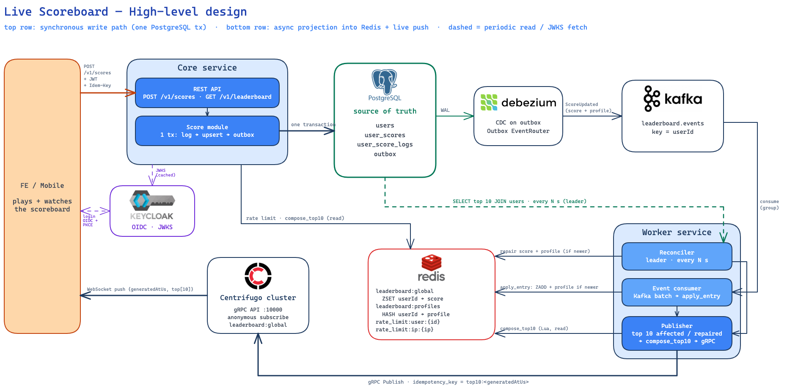
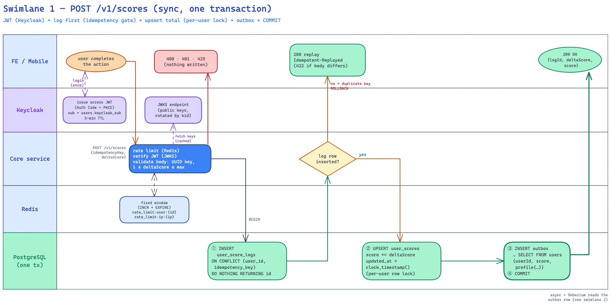
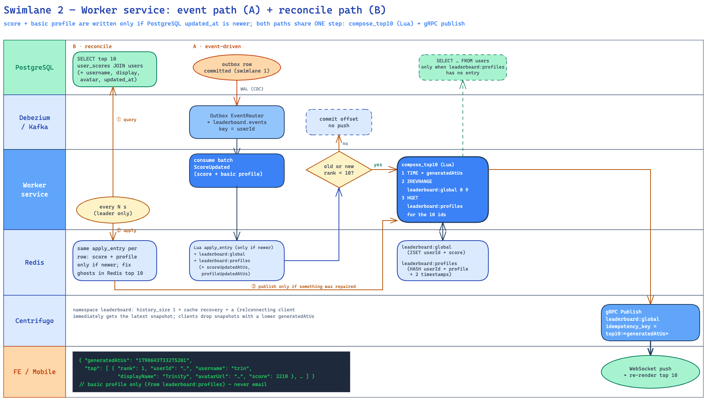
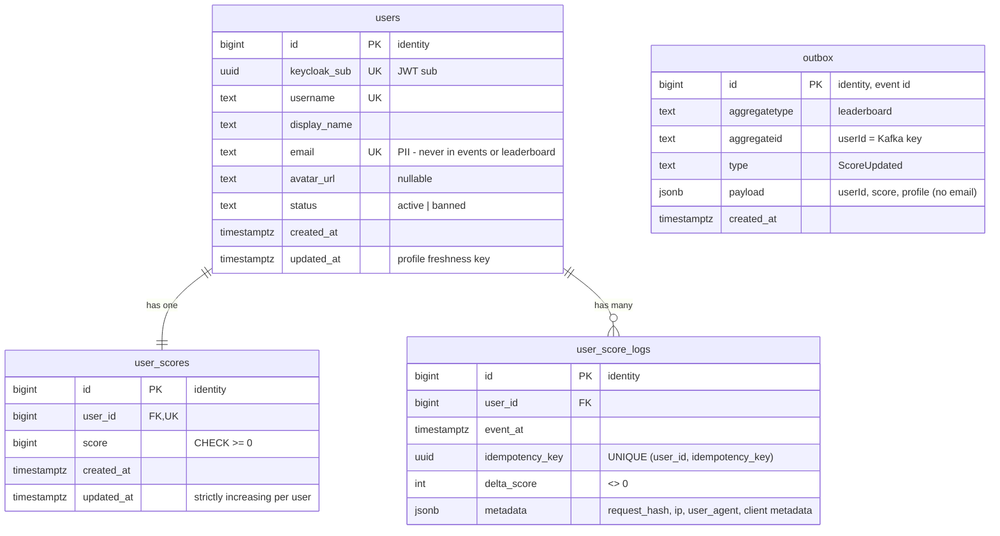

# Problem 6 — Live Scoreboard Module (Specification)

## 1. High-level design



Source: [`diagrams/high-level-design.excalidraw`](./diagrams/high-level-design.excalidraw) (open at excalidraw.com to edit; the icons are embedded).

- **Top row: synchronous write path.** FE → Core service → **one PostgreSQL transaction** (log → total → outbox). Debezium streams the outbox rows to Kafka.
- **Bottom row: async projection and live push.** The Worker service consumes Kafka and writes the Redis leaderboard (score + profile, only if newer). When the top 10 is affected, it builds the top 10 in Redis and publishes it to Centrifugo over gRPC. Centrifugo pushes it to FE / Mobile over WebSocket.
- **Dashed arrows:** the reconciler's periodic PostgreSQL read, and the Keycloak JWKS key fetches.

| Component | Responsibility |
|-----------|----------------|
| **FE / Mobile** | Logs in via Keycloak (Authorization Code + PKCE), calls the REST API, subscribes to `leaderboard:global`. |
| **Keycloak** | Issues access JWTs; Core validates them via the realm JWKS. |
| **Core service** | REST API, auth, rate limit, idempotency, the write transaction. Puts basic profile info into every outbox event. |
| **PostgreSQL** | Source of truth: `users`, `user_scores`, `user_score_logs`, `outbox`. |
| **Debezium** | Reads `outbox` inserts from the WAL, routes them to Kafka (Outbox Event Router). |
| **Kafka** | Topic `leaderboard.events`, key = `userId` → per-user ordering. |
| **Worker service** | Consumes events into the leaderboard (score + profile); reconciles the top 10 against Postgres every N s; publishes the top 10 to Centrifugo over gRPC when it was touched. |
| **Redis** | `leaderboard:global` (ranking), `leaderboard:profiles` (basic profile + freshness timestamps), `rate_limit:*`. All rebuildable from Postgres. |
| **Centrifugo** | WebSocket fan-out; server API over gRPC; history + cache recovery for reconnecting clients. |

---

## 2. API

Base path `/v1`. All endpoints require `Authorization: Bearer <Keycloak access token>` unless noted. `userId` is never read from the request: Core verifies the JWT, then resolves `sub` → `users.id` via `users.keycloak_sub` (cached). All ids are `bigint` in PostgreSQL and **strings** in JSON (JavaScript numbers are only exact up to 2^53).

### 2.1 `POST /v1/scores` — update score

```http
POST /v1/scores
Authorization: Bearer eyJ…
Content-Type: application/json

{
  "idempotencyKey": "0192f1c4-7b1e-7cc2-a1d0-9f3e5c2b8d10",
  "deltaScore": 10,
  "metadata": { "action": "daily_quiz" }
}
```

| Field | Rule |
|-------|------|
| `idempotencyKey` | required, UUID; generated once per completed action by the client |
| `deltaScore` | required, integer, `1 ≤ deltaScore ≤ maxDeltaScore` (config, e.g. 100) |
| `metadata` | optional JSON object (≤ 1 KB), stored in the score log for audit |

`200 OK` → `{ "logId": "1843221", "deltaScore": 10, "score": 1530 }`

A retry with the same `idempotencyKey` and the same body gets the same `logId` and `deltaScore`, the user's current `score`, and the header `Idempotent-Replayed: true`. The score is added only once.

### 2.2 `GET /v1/leaderboard` — top 10 (public)

```json
{ "generatedAtUs": "1790643733275201",
  "top": [ { "rank": 1, "userId": "7", "username": "trin", "displayName": "Trinity",
             "avatarUrl": "https://cdn.example.com/a/trin.png", "score": 2210 }, … ] }
```

Core runs `compose_top10.lua` (read-only, the same script the Worker uses), so the response has the same shape as the WebSocket push. Falls back to Postgres (`user_scores JOIN users`) if Redis is down.

### 2.3 Errors (`application/problem+json`, RFC 9457)

| Status | `code` | When |
|--------|--------|------|
| 400 | `VALIDATION_ERROR` | missing/non-UUID `idempotencyKey`, `deltaScore` not an integer in `1..maxDeltaScore`, `metadata` too large |
| 401 | `UNAUTHORIZED` | missing/invalid/expired JWT |
| 403 | `USER_BANNED` | user is banned |
| 422 | `IDEMPOTENCY_KEY_REUSED` | same key, different body |
| 429 | `RATE_LIMITED` | fixed-window limit reached (`Retry-After` = seconds left in the window) |
| 5xx | — | tx rolled back, nothing persisted → retry with the **same** key |

---

## 3. Flow — update score (Core service)



Guards, cheapest first, with no database writes:
- rate limit, fixed window per user and per IP:
  - `INCR rate_limit:user:{id}` and `INCR rate_limit:ip:{ip}`;
  - if a counter returns `1` (first hit of the window), `EXPIRE` it to the window length (e.g. 60 s);
  - above the limit (e.g. 30 per window) → `429`, with `Retry-After` = the key's `TTL`;
- JWT (cached JWKS);
- body: `idempotencyKey` is a UUID, `deltaScore` is in `1..maxDeltaScore`.

Then **one transaction** (`READ COMMITTED`, statement timeout ~2 s):

```sql
BEGIN;

-- ① log first: the UNIQUE key is the idempotency gate
INSERT INTO user_score_logs (user_id, idempotency_key, delta_score, metadata)
VALUES ($uid, $idempotency_key, $delta_score,
        jsonb_build_object('request_hash', $hash, 'ip', $ip, 'user_agent', $ua,
                           'client', $client_metadata))
ON CONFLICT (user_id, idempotency_key) DO NOTHING
RETURNING id;
-- 0 rows → ROLLBACK, read the existing log:
--          same request_hash → 200 replay, else 422 IDEMPOTENCY_KEY_REUSED

-- ② upsert the total; this takes the per-user row lock
INSERT INTO user_scores (user_id, score, updated_at)
VALUES ($uid, $delta_score, clock_timestamp())
ON CONFLICT (user_id) DO UPDATE
   SET score = user_scores.score + EXCLUDED.score,
       -- read AFTER the row lock → strictly increasing per user
       updated_at = GREATEST(clock_timestamp(), user_scores.updated_at + interval '1 microsecond')
RETURNING score, (extract(epoch FROM updated_at) * 1000000)::bigint AS updated_at_us;

-- ③ outbox event with basic leaderboard profile (same tx → no dual write)
INSERT INTO outbox (aggregatetype, aggregateid, type, payload)
SELECT 'leaderboard', u.id::text, 'ScoreUpdated',
       jsonb_build_object(
         'userId', u.id::text, 'score', $score, 'scoreUpdatedAtUs', $updated_at_us,
         'profile', jsonb_build_object(
            'username', u.username, 'displayName', u.display_name, 'avatarUrl', u.avatar_url,
            'updatedAtUs', (extract(epoch FROM u.updated_at) * 1000000)::bigint))
FROM users u WHERE u.id = $uid;                          -- PK lookup, no email
COMMIT;
```

Why this order is correct:
- **Concurrent duplicates** (same key): the second INSERT waits on the unique index until the first commits, then hits `DO NOTHING` and returns the replay. There is no "in progress" state to manage.
- **Two different updates in parallel:** step ② serialises them on the user row, so both deltas are added and `updated_at` stays strictly increasing.
- Any error before COMMIT → ROLLBACK → nothing persisted. A retry with the same key is safe.

**Client retry contract:** generate `idempotencyKey` once per completed action (UUIDv7) and keep it with the request until a final answer arrives. Retry with exponential backoff + jitter on `429`, `5xx` and timeouts, always with the **same** key. Stop on `2xx` and other `4xx`.

---

## 4. Flow — Worker service (consume, reconcile, publish)



The Worker service runs as N replicas in one consumer group. Every replica consumes Kafka. Only the **leader** runs the reconciler; leadership comes from `pg_try_advisory_lock(hashtext('leaderboard-worker'))` on a dedicated connection.

### 4.1 Path A — consume outbox events

Each `ScoreUpdated` event carries the score and the basic profile:

```json
{ "userId": "42", "score": 1530, "scoreUpdatedAtUs": 1790590502123456,
  "profile": { "username": "neo", "displayName": "Neo",
               "avatarUrl": "https://cdn.example.com/a/neo.png", "updatedAtUs": 1790500000000000 } }
```

For each event in a polled batch, one Lua call updates the leaderboard domain. Each part is written **only if it is newer**:

```lua
-- apply_entry.lua
-- KEYS: leaderboard:global, leaderboard:profiles
-- ARGV: userId, score, scoreUpdatedAtUs (-1 = none), username, displayName, avatarUrl, profileUpdatedAtUs (-1 = none)
local uid = ARGV[1]
local raw = redis.call('HGET', KEYS[2], uid)
local e = raw and cjson.decode(raw) or {}
local old = redis.call('ZREVRANK', KEYS[1], uid)                     -- false if absent
local changed = 0
if tonumber(ARGV[3]) > tonumber(e.scoreUpdatedAtUs or '-1') then
  redis.call('ZADD', KEYS[1], ARGV[2], uid)                           -- absolute score, never ZINCRBY
  e.scoreUpdatedAtUs = ARGV[3]
  changed = changed + 1
end
if tonumber(ARGV[7]) > tonumber(e.profileUpdatedAtUs or '-1') then
  e.username, e.displayName, e.avatarUrl, e.profileUpdatedAtUs = ARGV[4], ARGV[5], ARGV[6], ARGV[7]
  changed = changed + 2
end
if changed > 0 then redis.call('HSET', KEYS[2], uid, cjson.encode(e)) end
local new = redis.call('ZREVRANK', KEYS[1], uid)
return {old or -1, new or -1, changed}                                -- changed: 1=score, 2=profile, 3=both
```

Timestamps are stored as **strings**: Redis' cjson encodes numbers with 14 significant digits, and epoch microseconds have 16.

- The top 10 is **affected** if `changed > 0` and (`0 ≤ oldRank < 10` or `0 ≤ newRank < 10`). Most events are far below the top 10 and stop here.
- After the batch, if any event affected the top 10 → **publish once** (4.3). Then commit the Kafka offsets.
  Batching coalesces bursts, so 500 events in one poll give at most one push.

### 4.2 Path B — reconcile (leader, every N s, configurable, e.g. 10 s)

1. Read the top 10 with its basic profile from the source of truth:

   ```sql
   SELECT us.user_id, us.score,
          (extract(epoch FROM us.updated_at) * 1000000)::bigint AS score_updated_at_us,
          u.username, u.display_name, u.avatar_url,
          (extract(epoch FROM u.updated_at) * 1000000)::bigint  AS profile_updated_at_us
   FROM user_scores us
   JOIN users u ON u.id = us.user_id
   ORDER BY us.score DESC, us.updated_at ASC
   LIMIT 10;
   ```

2. For each row, call **the same `apply_entry.lua`** with both timestamps:
   - **Score:** the ZSET is updated only if the entry's `scoreUpdatedAtUs` < `user_scores.updated_at`.
   - **Profile:** the profile fields are updated only if the entry's `profileUpdatedAtUs` < `users.updated_at`.
   - Otherwise nothing is written: Redis already has the same or newer data. For example, the consumer may have applied a later event after this SELECT ran, and the reconciler must never roll it back.
3. For each current Redis top-10 member that is **not** in the Postgres top 10, re-read its row and apply it the same way. If the user no longer exists, `ZREM` it and `HDEL` its `leaderboard:profiles` entry. This removes ghosts and stale high scores.
4. **Publish** (4.3) only if something was repaired: any `changed > 0` for these rows, or a ghost removed. Otherwise nothing is sent.

This covers the cases where events are lost or delayed: Debezium restart, poison message, Redis failover, a manual fix in the DB.

### 4.3 Publish (shared by A and B)

1. Build the top 10 with one Lua call. It is atomic, so ranking and profiles come from the same instant:

   ```lua
   -- compose_top10.lua   KEYS: leaderboard:global, leaderboard:profiles
   local t = redis.call('TIME')
   local ids = redis.call('ZREVRANGE', KEYS[1], 0, 9, 'WITHSCORES')
   local top = {}
   for i = 1, #ids, 2 do
     local raw = redis.call('HGET', KEYS[2], ids[i])
     local p = raw and cjson.decode(raw) or {}
     top[#top + 1] = { rank = (i + 1) / 2, userId = ids[i], score = tonumber(ids[i + 1]),
                       username = p.username, displayName = p.displayName, avatarUrl = p.avatarUrl }
   end
   return cjson.encode({ generatedAtUs = t[1] .. string.format('%06d', t[2]), top = top })
   ```

2. **gRPC publish** the result to Centrifugo (§5) with `idempotency_key = "top10:<generatedAtUs>"`.

Why no stored snapshot or sequence is needed:
- **`generatedAtUs` orders snapshots.** It comes from Redis `TIME` inside the same atomic script that reads the data, and Redis runs scripts one at a time. So a later `generatedAtUs` always means newer data. Two replicas may publish close together, possibly out of order; the client keeps the snapshot with the highest `generatedAtUs`.
- **A duplicate publish is harmless.** Each message is a full snapshot, so re-sending the same top 10 changes nothing on screen.
- **A profile entry missing** for a top-10 user should not happen, because every ranked user got a profile with their event. If one does, the fields are empty until the next reconcile tick fills them from `users`.

---

## 5. Centrifugo over gRPC

Centrifugo config (v6):

```json
{
  "grpc_api": { "enabled": true, "port": 10000, "key": "<secret>" },
  "client": { "allow_anonymous_connect_without_token": true },
  "channel": {
    "namespaces": [
      { "name": "leaderboard",
        "allow_subscribe_for_anonymous": true, "allow_subscribe_for_client": true,
        "history_size": 1, "history_ttl": "300s",
        "force_recovery": true, "force_recovery_mode": "cache" }
    ]
  }
}
```

Publish from the Worker:
- Use stubs generated from Centrifugo's `api.proto` (service `CentrifugoApi`).
- Keep one long-lived HTTP/2 channel, load-balanced over the nodes.

```text
rpc CentrifugoApi.Publish(PublishRequest) returns (PublishResponse)
metadata:  authorization: apikey <secret>
deadline:  500 ms
request:   { channel: "leaderboard:global", data: <json {generatedAtUs, top}>, idempotency_key: "top10:<generatedAtUs>" }
```

- Check both the gRPC status **and** `PublishResponse.error`. API errors come back in the body with gRPC status `OK`.
- Retry `UNAVAILABLE` / `DEADLINE_EXCEEDED` with backoff and the same `idempotency_key`, so Centrifugo drops the duplicate.
- Payloads are **full snapshots**. The client replaces its list and ignores one with a lower `generatedAtUs`.
- Thanks to cache recovery (`history_size: 1`), a client that subscribes or reconnects gets the latest snapshot immediately. It should still call `GET /v1/leaderboard` on first render.
- **No JWT on the WebSocket.** The scoreboard is public data, so clients connect anonymously and only subscribe to `leaderboard:global`. Only the Worker can publish (gRPC API key, private network).

---

## 6. Data model



Invariant: `SUM(user_score_logs.delta_score) GROUP BY user_id = user_scores.score`. The Worker leader checks it nightly and **alerts** on a mismatch, without auto-fixing.

### DDL (PostgreSQL 16)

```sql
CREATE TABLE users (
  id            bigint GENERATED ALWAYS AS IDENTITY PRIMARY KEY,
  keycloak_sub  uuid NOT NULL UNIQUE,                   -- JWT "sub"
  username      text NOT NULL UNIQUE,
  display_name  text NOT NULL,
  email         text NOT NULL UNIQUE,
  avatar_url    text,
  status        text NOT NULL DEFAULT 'active' CHECK (status IN ('active', 'banned')),
  created_at    timestamptz NOT NULL DEFAULT now(),
  -- profile edits set updated_at = GREATEST(clock_timestamp(), updated_at + 1 µs)
  -- (freshness key for leaderboard:profiles)
  updated_at    timestamptz NOT NULL DEFAULT clock_timestamp()
);

CREATE TABLE user_scores (
  id          bigint GENERATED ALWAYS AS IDENTITY PRIMARY KEY,
  user_id     bigint NOT NULL UNIQUE REFERENCES users (id),
  score       bigint NOT NULL DEFAULT 0 CHECK (score >= 0),
  created_at  timestamptz NOT NULL DEFAULT now(),
  updated_at  timestamptz NOT NULL DEFAULT clock_timestamp()  -- freshness key for Redis
);
CREATE INDEX user_scores_rank_idx ON user_scores (score DESC, updated_at ASC);

-- append-only score log (also the idempotency store)
CREATE TABLE user_score_logs (
  id               bigint GENERATED ALWAYS AS IDENTITY PRIMARY KEY,
  user_id          bigint NOT NULL REFERENCES users (id),
  event_at         timestamptz NOT NULL DEFAULT now(),
  idempotency_key  uuid NOT NULL,                       -- generated by the client
  delta_score      int NOT NULL CHECK (delta_score <> 0),
  metadata         jsonb NOT NULL DEFAULT '{}'::jsonb,
  CONSTRAINT user_score_logs_idem_uq UNIQUE (user_id, idempotency_key)
);
CREATE INDEX user_score_logs_user_idx ON user_score_logs (user_id, event_at DESC);

-- transactional outbox (column names = Debezium Outbox Event Router defaults)
CREATE TABLE outbox (
  id             bigint GENERATED ALWAYS AS IDENTITY PRIMARY KEY,
  aggregatetype  text NOT NULL,
  aggregateid    text NOT NULL,
  type           text NOT NULL,
  payload        jsonb NOT NULL,
  created_at     timestamptz NOT NULL DEFAULT now()
);

-- requires wal_level = logical
CREATE PUBLICATION dbz_leaderboard FOR TABLE outbox;

-- append-only: the app role gets no UPDATE/DELETE on the log
-- GRANT SELECT, INSERT ON user_score_logs TO core_app;
```

Outbox housekeeping: rows are needed only until Debezium has read the WAL. Delete rows older than 1 h in batches, or `DELETE` in the same transaction right after the `INSERT`; Debezium still sees the insert.

### Debezium connector


Event on `leaderboard.events` (key = `aggregateid` = userId; header `id` = event id for dedupe):

```json
{ "userId": "42", "score": 1530, "scoreUpdatedAtUs": 1790590502123456,
  "profile": { "username": "neo", "displayName": "Neo",
               "avatarUrl": "https://cdn.example.com/a/neo.png", "updatedAtUs": 1790500000000000 } }
```

### Redis keys

| Key | Type | Owner | Content |
|-----|------|-------|---------|
| `leaderboard:global` | ZSET | Worker | member = userId, score = total |
| `leaderboard:profiles` | HASH | Worker | userId → `{"username","displayName","avatarUrl","scoreUpdatedAtUs","profileUpdatedAtUs"}` for every ranked user (no email) |
| `rate_limit:user:{id}` / `rate_limit:ip:{ip}` | STRING | Core | fixed-window counter: `INCR`; `EXPIRE <window>` on the first hit of the window |

---

## 7. Suggested implementation layout

```
core-service/src/modules/
  score/   score.controller.ts · leaderboard.controller.ts · score.service.ts (the tx)
  common/  rate-limit.ts (fixed window)

worker-service/src/
  consumer.ts        # Kafka batch → apply_entry.lua → publish if top 10 affected
  reconciler.ts      # leader tick: PG top 10 + users → apply_entry.lua → publish if repaired
  publisher.ts       # compose_top10.lua + gRPC publish
  leader.ts          # pg advisory lock
  centrifugo.grpc.ts # generated from api.proto, retries, idempotency_key
  lua/apply_entry.lua · lua/compose_top10.lua
```
